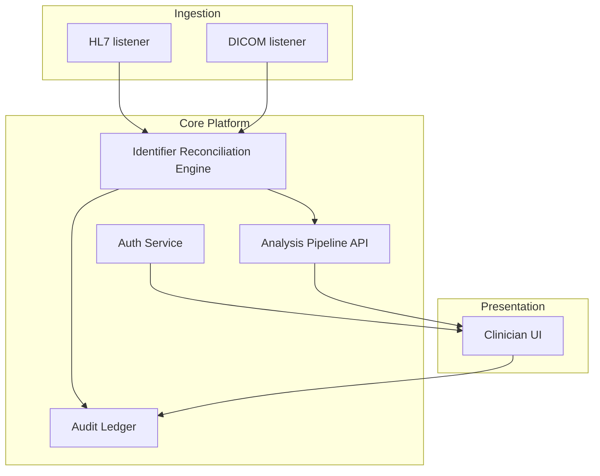

# Functional Design Specification

This document gives a high-level view of DemoScan's architecture and links each design decision to
the requirements, tests and risks behind it. Any ID it mentions, such as **RISK-001**, links to that
item in the pack.

## Architecture overview

The system is split into ingestion, core and presentation tiers, to meet **REQ-001** to **REQ-004**
while keeping a clean boundary for identifier reconciliation (**REQ-005**).

## Identifier reconciliation engine (REQ-005, RISK-001, TEST-002)

The reconciliation engine protects against **RISK-001**, where patient and study identifiers are
mismatched.

- Compare the DICOM `PatientID` and `AccessionNumber` with the HL7 metadata.
- Quarantine the study when they disagree; **TEST-002** checks the quarantine and the review queue.
- Emit an audit event for every stored or quarantined study.

## Authentication (REQ-001, RISK-002, TEST-001)

Authentication uses OpenID Connect. Tokens carry the clinician's study permissions, and middleware
checks them on every API endpoint.

## Import and analysis (REQ-002, REQ-003, RISK-003, RISK-004)

The import module validates and normalises DICOM before the analysis pipelines of **REQ-003** run.
The pipelines record, for regulatory review:

- the DICOM validation log of each import;
- image-derived measurements, tied to their source series;
- warnings for saturated or out-of-range values (**RISK-004**).

## Operational documents

Installation and operation are described in the Installation & User Specification, which links to
**TEST-005** for the end-to-end intake check.
