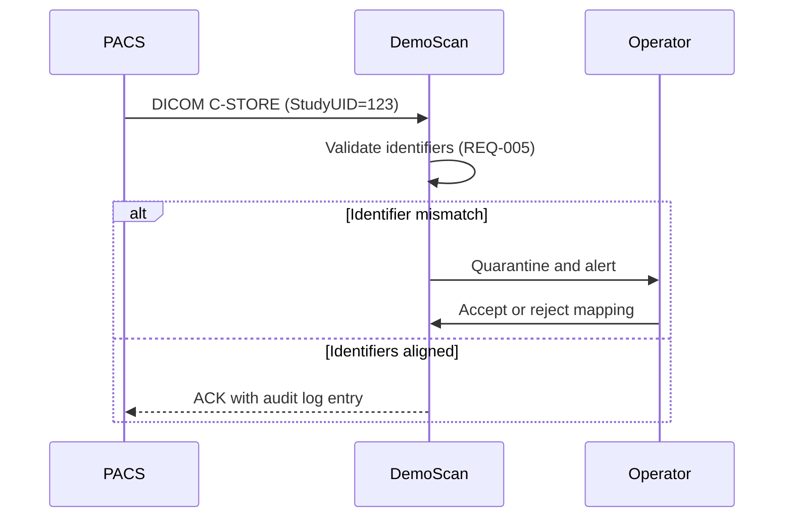

# Platform Requirements

The platform requirements derive from the Tier 1 requirements. Each names its Tier 1 parent on a
`Parent:` line. The sub-sections under each requirement also show the Markdown that TraceFlow
typesets: inline code, images, tables, code blocks and mermaid diagrams.

## REQ-001: User authentication

Parent: REQ-T1-001

Users must sign in with their email address and a password before they can see any study.

### Example inline code formatting

The ID of the user is, e.g., `1af345e6`.

## REQ-002: MRI dataset import

Parent: REQ-T1-001

The platform must import MRI datasets in DICOM format and refuse files that are not valid DICOM.

### Example image (.png)


## REQ-003: Image analysis pipeline

Parent: REQ-T1-002

- The platform should provide a Python API for building image analysis pipelines.
- The pipelines must be able to process MRI datasets in a compliant way.

### Example flow chart (using mermaid)


### Example code block

```python
def hello_world():
    print("Hello world!")
```

## REQ-004: Output data

Parent: REQ-T1-002

The platform must export the results of image analysis pipelines in a standard format, including
the following parameters:

| **DICOM Series**       | **Key Parameters**              | **Typical Parameters**                          | **Map to Image Type** |
|------------------------|---------------------------------|-------------------------------------------------|-----------------------|
| T1 VFA                 | TR, TE, FA                      | 96x96x24 FA=2°,17°,32°                          | `vfa`                 |
| High-res pre-contrast  | TR, TE, FA                      | 512x512x92 FA=32°                               | `high-res-pre`        |
| T1-weighted dynamic    | TR, TE, FA, Temporal resolution | 96x96x24  FA=17° Temporal resolution: 2s to 10s | `dynamic-uncorrected` |
| High-res post-contrast | TR, TE, FA                      | 512x512x92 FA=32°                               | `high-res-post`       |

## REQ-005: Patient-study reconciliation

Parent: REQ-T1-001

The ingestion service shall keep study metadata associated with the correct patient identifier,
to reduce **RISK-001**.

- Cross-validate the incoming HL7 and DICOM identifiers before persisting them.
- Quarantine mismatches for operator review.
- Provide a reconciliation webhook so downstream systems can resynchronise identifiers.

### Example sequence diagram


